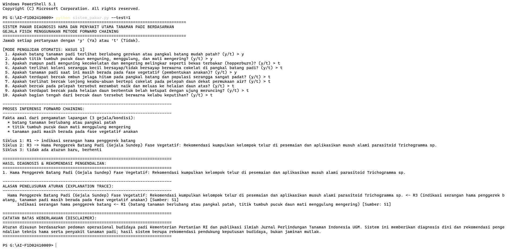
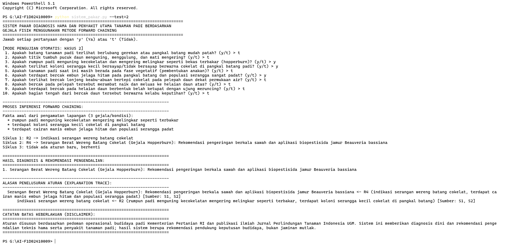
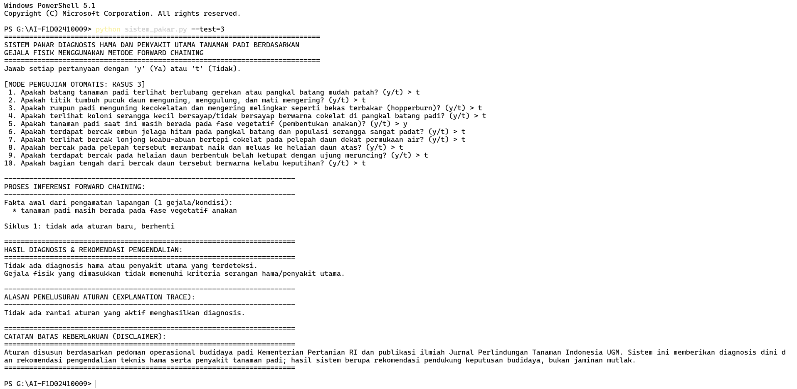

# Sistem Pakar Diagnosis Hama dan Penyakit Utama Tanaman Padi Berdasarkan Gejala Fisik Menggunakan Metode Forward Chaining

Tugas 5 — Mata Kuliah Kecerdasan Buatan (MKL1303131)  
Program Studi Teknik Informatika, Fakultas Teknik, Universitas Mataram

---

* **Nama** : I WAYAN GIRINDRA PRASASTA
* **NIM** : F1D02410009
* **Mata Kuliah** : Kecerdasan Buatan (Materi 5 - Sistem Pakar)
* **Dosen Pengampu** : Pahrul Irfan, S.Kom., M.Kom

---

## 2. Topik & Cara Menjalankan Program

### Topik & Judul
**Judul Sistem Pakar:**  
*Sistem Pakar Diagnosis Hama dan Penyakit Utama Tanaman Padi Berdasarkan Gejala Fisik Menggunakan Metode Forward Chaining*

**Deskripsi Singkat:**  
Sistem pakar ini dirancang untuk membantu petani dan praktisi pertanian dalam mengidentifikasi secara dini serangan hama dan infeksi penyakit utama pada tanaman padi sawah (seperti Penggerek Batang Padi/Sundep, Wereng Batang Cokelat/Hopperburn, Hawar Pelepah Daun, dan Blas Daun) berdasarkan gejala fisik visual yang teramati di lapangan, serta memberikan rekomendasi tindakan pengendalian teknis yang tepat sasaran.

### Spesifikasi Bahasa & Lingkungan
* **Bahasa Pemrograman**: Python
* **Versi Minimum**: Python 3.8+ (Diuji pada Python 3.12.7)
* **Pustaka (*Dependencies*)**: Pustaka standar bawaan Python (`json`, `sys`, `os`, `textwrap`), tanpa perlu menginstal pustaka eksternal (*zero external dependencies*).

### Cara Menjalankan Program
1. Buka terminal atau Command Prompt dan arahkan ke folder ini:
   ```bash
   cd "AI-F1D02410009"
   ```
2. **Mode Interaktif (Tanya Jawab Langsung)**:
   ```bash
   python sistem_pakar.py
   ```
   Jawab setiap pertanyaan gejala dengan mengetikkan `y` (Ya) atau `t` (Tidak), lalu tekan Enter.
3. **Mode Pengujian Otomatis (Kasus Uji 1, 2, atau 3)**:
   ```bash
   # Menjalankan Kasus 1 (Diagnosis Hama Penggerek Batang Padi / Sundep)
   python sistem_pakar.py --test=1

   # Menjalankan Kasus 2 (Diagnosis Wereng Batang Cokelat / Hopperburn)
   python sistem_pakar.py --test=2

   # Menjalankan Kasus 3 (Kasus Negatif / Tanpa Gejala Serangan)
   python sistem_pakar.py --test=3
   ```

---

## 3. Daftar Sumber & Tabel Aturan

### A. Daftar Sumber Pengetahuan Resmi (3 Referensi)
1. **[S1] Situs Pemerintah (Kementerian Pertanian RI)**
   * **Judul**: *Prosedur Operasional Standar (POS) Budi Daya Padi Sawah: Pengendalian Organisme Pengganggu Tumbuhan (OPT)*
   * **Penerbit**: Badan Penelitian dan Pengembangan Pertanian, Kementerian Pertanian Republik Indonesia
   * **URL**: [https://ppid.pertanian.go.id/doc/1/Budidaya/Budi%20Daya%20Padi%20Sawah.pdf](https://ppid.pertanian.go.id/doc/1/Budidaya/Budi%20Daya%20Padi%20Sawah.pdf)
   * **Tanggal Akses**: 14 November 2026
   * **Kaidah yang Diambil**: Identifikasi gejala serangan hama penggerek batang padi (*Scirpophaga incertulas*) fase sundep dan beluk, ambang ekonomi pengendalian, serta sanitasi pengendalian penyakit blas (*Pyricularia oryzae*).

2. **[S2] Jurnal Ilmiah (Jurnal Perlindungan Tanaman Indonesia UGM)**
   * **Judul**: *Potensi Parasitoid Telur dalam Mengendalikan Wereng Batang Cokelat (Nilaparvata lugens Stal.) Pasca Ledakan*
   * **Penulis**: Endang Warih Minarni, dkk.
   * **Penerbit**: *Jurnal Perlindungan Tanaman Indonesia*, Fakultas Pertanian UGM, Vol. 22, No. 2 (2018), hal. 132–142
   * **DOI / URL**: [https://doi.org/10.22146/jpti.28886](https://doi.org/10.22146/jpti.28886) / [journal.ugm.ac.id/jpti/article/view/28886](https://journal.ugm.ac.id/jpti/article/view/28886)
   * **Tanggal Akses**: 14 November 2026
   * **Kaidah yang Diambil**: Bioekologi dan karakteristik serangan wereng batang cokelat (WBC), kepadatan populasi pemicu gejala menguning melingkar (*hopperburn*), serta pemanfaatan musuh alami pengendali hayati.

3. **[S3] Jurnal Ilmiah & Balai Riset (JPTI UGM & Balai Besar Penelitian Tanaman Padi)**
   * **Judul**: *Penyakit Hawar Pelepah (Rhizoctonia solani) pada Padi dan Taktik Pengelolaannya*
   * **Penulis**: Bambang Nuryanto (Peneliti BBPadi Kementan)
   * **Penerbit**: *Jurnal Perlindungan Tanaman Indonesia*, Vol. 21, No. 2 (2017), hal. 63–71
   * **DOI / URL**: [https://doi.org/10.22146/jpti.22494](https://doi.org/10.22146/jpti.22494) / [journal.ugm.ac.id/jpti/article/view/22494](https://journal.ugm.ac.id/jpti/article/view/22494)
   * **Tanggal Akses**: 14 November 2026
   * **Kaidah yang Diambil**: Karakteristik morfologi bercak hawar pelepah (*Rhizoctonia solani*) di pelepah dekat air, pola perambatan vertikal ke daun atas, serta taktik budidaya penekanan penyakit (jarak tanam jajar legowo dan efisiensi pupuk N).

---

### B. Tabel Aturan IF-THEN (*Knowledge Base*)

Basis pengetahuan disimpan dalam file `kb_padi.json` dengan struktur berikut:

| ID | Premis Kondisi (IF) | Mode | Kesimpulan / Hasil (THEN) | Sumber | Rantai (*Chaining*) |
| :---: | :--- | :---: | :--- | :---: | :--- |
| **R1** | • batang tanaman berlubang atau pangkal patah<br>• titik tumbuh pucuk daun mati menggulung mengering | **dan** *(AND)* | `indikasi serangan hama penggerek batang` | S1 | Menghasilkan fakta perantara (*intermediate fact*) |
| **R2** | • rumpun padi menguning kecokelatan mengering melingkar seperti terbakar<br>• terdapat koloni serangga kecil cokelat di pangkal batang | **dan** *(AND)* | `indikasi serangan wereng batang cokelat` | S1, S2 | Menghasilkan fakta perantara (*intermediate fact*) |
| **R3** | • **indikasi serangan hama penggerek batang** *(hasil R1)*<br>• tanaman padi masih berada pada fase vegetatif anakan | **dan** *(AND)* | **Hama Penggerek Batang Padi (Gejala Sundep) Fase Vegetatif: Rekomendasi kumpulkan kelompok telur di pesemaian dan aplikasikan musuh alami parasitoid Trichogramma sp.** | S1 | **Kesimpulan Akhir 1** *(Chaining dari R1)* |
| **R4** | • **indikasi serangan wereng batang cokelat** *(hasil R2)*<br>• terdapat cairan manis embun jelaga hitam dan populasi serangga padat | **dan** *(AND)* | **Serangan Berat Wereng Batang Cokelat (Gejala Hopperburn): Rekomendasi pengeringan berkala sawah dan aplikasi biopestisida jamur Beauveria bassiana** | S1, S2 | **Kesimpulan Akhir 2** *(Chaining dari R2)* |
| **R5** | • terdapat bercak lonjong keabu-abuan dengan tepi cokelat pada pelepah dekat permukaan air<br>• bercak merambat meluas ke pelepah daun bagian atas | **dan** *(AND)* | **Penyakit Hawar Pelepah Daun (Rhizoctonia solani): Rekomendasi atur jarak tanam jajar legowo dan kurangi dosis pupuk Nitrogen berlebih** | S1, S3 | **Kesimpulan Akhir 3** |
| **R6** | • terdapat bercak daun berbentuk belah ketupat dengan ujung meruncing<br>• bagian tengah bercak berwarna kelabu keputihan | **dan** *(AND)* | **Penyakit Blas Daun (Pyricularia oryzae): Rekomendasi perlakuan benih fungisida dan sanitasi sisa jerami tanaman yang terinfeksi** | S1 | **Kesimpulan Akhir 4** |

---

## 4. Metode Inferensi yang Dipilih & Alasannya

Metode yang dipilih adalah **Forward Chaining (FC)** (*data-driven reasoning*).

### Alasan Pemilihan Forward Chaining:
1. **Sesuai Pola Diagnosis Lapangan Petani**:  
   Ketika petani memeriksa sawah, mereka mengamati gejala-gejala fisik visual yang tampak terlebih dahulu (melihat daun mati pucuk, batang berlubang, serangga di pangkal, atau bentuk bercak). Penalaran maju (*forward chaining*) bergerak secara alami dari gejala-gejala awal ini menuju identifikasi hama/penyakit dan rekomendasi tindakan.
2. **Mendukung Inferensi Berantai Bertingkat (*Chaining*)**:  
   Aturan R1 dan R2 menyimpulkan indikasi awal patogen/hama (`indikasi serangan hama penggerek batang` dan `indikasi serangan wereng batang cokelat`), kemudian aturan tingkat berikutnya (R3 dan R4) mengombinasikannya dengan fase tumbuh tanaman atau kepadatan populasi untuk menentukan diagnosis spesifik dan rekomendasi pengendaliannya.
3. **Penyajian Alasan (*Explanation Trace*) yang Transparan**:  
   Sistem dapat menampilkan urutan siklus penalaran langkah demi langkah (`Siklus 1 -> Siklus 2 -> ...`), sehingga pengguna memahami aturan dan bukti apa saja yang mendasari hasil diagnosis tersebut.

---

## 5. Tiga Kasus Uji & Screenshot Hasil Eksekusi

### Ringkasan Kasus Uji
| # | Skenario Gejala Bernilai "Ya" | Kesimpulan yang Diharapkan | Status Hasil |
| :-: | :--- | :--- | :-: |
| **1** | • Batang tanaman berlubang/patah<br>• Titik tumbuh pucuk daun mati menggulung<br>• Tanaman padi masih fase vegetatif anakan | **Hama Penggerek Batang Padi (Gejala Sundep) Fase Vegetatif: Rekomendasi kumpulkan kelompok telur di pesemaian dan aplikasikan musuh alami parasitoid Trichogramma sp.** | **Berhasil (Positif)** |
| **2** | • Rumpun menguning melingkar seperti terbakar<br>• Terdapat serangga kecil cokelat di pangkal<br>• Terdapat embun jelaga hitam & populasi padat | **Serangan Berat Wereng Batang Cokelat (Gejala Hopperburn): Rekomendasi pengeringan berkala sawah dan aplikasi biopestisida jamur Beauveria bassiana** | **Berhasil (Positif)** |
| **3** | • Tanaman padi masih berada pada fase vegetatif anakan *(hanya info fase, tanpa gejala serangan)* | **Tidak ada diagnosis hama atau penyakit utama yang terdeteksi** *(gejala tidak memenuhi kriteria)* | **Berhasil (Kasus Negatif)** |

---

### Screenshot Kasus 1: Diagnosis Penggerek Batang Padi (Sundep)
Gejala batang berlubang dan pucuk mati menggulung pada fase vegetatif memicu R1 dan R3 secara berantai:



---

### Screenshot Kasus 2: Diagnosis Wereng Batang Cokelat (Hopperburn)
Gejala menguning melingkar seperti terbakar dan adanya koloni serangga padat dengan embun jelaga memicu R2 dan R4 secara berantai:



---

### Screenshot Kasus 3: Kasus Negatif (Tanpa Kesimpulan)
Pengguna hanya memasukkan fakta bahwa tanaman berada pada fase vegetatif tanpa adanya gejala fisik penyakit/hama. Mesin forward chaining berhenti pada siklus pertama:



---

## 6. Batas Keberlakuan (*Disclaimer*)

Basis pengetahuan dan aturan sistem pakar ini dirumuskan berdasarkan pedoman teknis budidaya padi dari Badan Penelitian dan Pengembangan Pertanian (Kementerian Pertanian RI) serta publikasi ilmiah dari Fakultas Pertanian Universitas Gadjah Mada (UGM) dan Balai Besar Penelitian Tanaman Padi (BBPadi). Sistem ini dirancang untuk diagnosis awal dan panduan pengendalian Organisme Pengganggu Tumbuhan (OPT) utama pada tanaman padi sawah. Rekomendasi teknis yang dihasilkan oleh sistem ini bersifat **saran pendukung keputusan (*decision support*)**, bukan keputusan mutlak, dan penerapan pestisida/tindakan kimiawi di lapangan tetap harus memperhatikan anjuran Petugas Pengamat Organisme Pengganggu Tumbuhan (POPT) serta prinsip Pengendalian Hama Terpadu (PHT) setempat.

---

## 7. Penggunaan Alat Bantu AI
* **Status Penggunaan AI**: **Digunakan sebagai alat bantu belajar**.
* **Alat yang Digunakan**: Google DeepMind Agentic AI (Antigravity).
* **Rincian Pemanfaatan**:
  1. Menelaah pedoman penyusunan sistem pakar dari silabus Tugas 5 Kecerdasan Buatan.
  2. Membantu penelusuran referensi resmi Kementerian Pertanian dan Jurnal Perlindungan Tanaman Indonesia UGM.
  3. Membantu memetakan hubungan gejala fisik tanaman ke dalam format basis pengetahuan JSON (`kb_padi.json`) dan algoritma *Forward Chaining*.
  4. Penyusunan draf dokumentasi `README.md` dan skrip pengujian otomatis.
* **Pertanggungjawaban**: Seluruh struktur aturan, kode program, dan dokumentasi telah dipahami secara utuh dan dapat dipertanggungjawabkan serta dijelaskan secara mandiri di hadapan dosen penguji.
